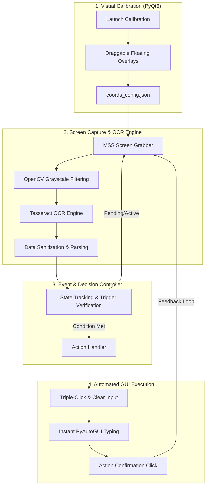

# Screen Vision Automator 🚀

[](https://www.python.org/)
[](https://riverbankcomputing.com/software/pyqt/)
[](https://opencv.org/)
[](https://github.com/tesseract-ocr/tesseract)
[](LICENSE)
[]()

**Screen Vision Automator** is a lightweight, non-invasive desktop Robotic Process Automation (RPA) and vision-guided automation framework built in Python.

It provides an interactive, visual coordinate calibration overlay system that eliminates hardcoded screen coordinates. By combining high-speed multi-region screen capture (`MSS`), optical character recognition (`OpenCV` + `Tesseract OCR`), and low-latency input automation (`PyAutoGUI`), the system can monitor dynamic desktop interfaces and execute state-driven actions in real time without requiring private APIs, web scrapers, or browser extensions.

---

## 🏗️ Architecture & Workflow



---

## ✨ Key Features

- 🎯 **Interactive Screen Calibration (ROI Selection):** Drag and resize translucent floating overlays (`PyQt6`) directly over any target interface to calibrate tracking coordinates visually without manual pixel measurement.
- 💾 **Persistent Configuration:** Automatically saves and restores target area boundaries from `coords_config.json`.
- ⚡ **Ultra-Fast Screen Capture:** Employs `MSS` for minimal CPU usage and sub-millisecond screen grabbing.
- 🔍 **Optimized OCR Pipeline:** Utilizes Tesseract OCR configured specifically for rapid numerical extraction (`--psm 7` with character whitelisting) and `OpenCV` grayscale pre-filtering.
- 🤖 **Low-Latency GUI Action Handler:** Executes responsive mouse and keyboard sequences with customizable intervals, input clearing fallbacks, and safety thresholds.
- 🔄 **State Verification & History Tracking:** Tracks historical trends and verifies UI state transitions before dispatching subsequent actions.
- 🌐 **Zero-API Dependency:** Works universally across web browsers, desktop applications, streaming video windows, and legacy software.

---

## 📁 Repository Structure

```text
screen-vision-automator/
├── action_handler.py     # Mouse & keyboard execution engine (PyAutoGUI)
├── coords_config.json    # Persistent JSON storage for coordinate areas
├── generate_window.py    # PyQt6 visual overlay windows for ROI calibration
├── main.py               # Main GUI controller, event loop, and strategy coordinator
├── read_screen.py        # High-performance screen capture (MSS) and OCR module
├── requirements.txt      # Python package dependencies
├── .gitignore            # Git exclusion rules
└── README.md             # Project documentation
```

---

## 🧩 Core Modules Explained

| Module | Responsibility |
| :--- | :--- |
| **`generate_window.py`** | Creates always-on-top, semi-transparent PyQt6 overlay widgets that users can freely move and resize to define Regions of Interest (ROI). |
| **`read_screen.py`** | Captures target bounding boxes using `mss`, processes raw frames with `OpenCV`, and extracts numerical values using `pytesseract`. |
| **`action_handler.py`** | Coordinates automated actions (rapid field selection, clearing, typing, and clicking) with configurable latency limits. |
| **`main.py`** | The central orchestrator that provides the controller UI, loads configuration, manages the scanning loop, and triggers event-driven routines. |
| **`coords_config.json`** | Serialized bounding box definitions (`top`, `left`, `width`, `height`) for all monitored screen areas. |

---

## 🛠️ Prerequisites

### 1. Python
- **Python 3.9+** is required.

### 2. Tesseract OCR Engine
Install the Tesseract OCR engine on your system:

- **macOS:**
  ```bash
  brew install tesseract
  ```
- **Ubuntu / Debian:**
  ```bash
  sudo apt update
  sudo apt install -y tesseract-ocr
  ```
- **Windows:**
  - Download and install the latest Windows installer from [UB-Mannheim Tesseract](https://github.com/UB-Mannheim/tesseract/wiki).
  - Add the Tesseract installation directory (e.g., `C:\Program Files\Tesseract-OCR`) to your system `PATH`.

---

## 🚀 Installation & Quick Start

1. **Clone the repository:**
   ```bash
   git clone https://github.com/methun404/screen-vision-automator.git
   cd screen-vision-automator
   ```

2. **Create and activate a virtual environment (Recommended):**
   ```bash
   python3 -m venv venv
   source venv/bin/activate  # On Windows use: venv\Scripts\activate
   ```

3. **Install dependencies:**
   ```bash
   pip install -r requirements.txt
   ```

4. **Launch the Controller:**
   ```bash
   python main.py
   ```

---

## 📖 Step-by-Step Usage Guide

```
+------------------------------------------+
|          Bot Controller (PyQt6)          |
| +--------------------------------------+ |
| |       🎯 1. Set Coordinates          | |
| +--------------------------------------+ |
| |       📥 2. Get Coordinates          | |
| +--------------------------------------+ |
| |       ▶️ 3. Start Scanning           | |
| +--------------------------------------+ |
+------------------------------------------+
```

1. **Step 1: Set Coordinates (`🎯 1. Set Coordinates`)**
   - Click this button to launch translucent blue overlay windows for each target region (`multiplier`, `balance`, `history`, `bet_amount`, `bet_button`).
   - Drag and resize each overlay rectangle until it snugly fits over the corresponding area on your target application screen.

2. **Step 2: Save Coordinates (`📥 2. Get Coordinates`)**
   - Click to capture the new coordinates from all active overlay windows.
   - The overlays will automatically close, and your calibrated layout will be saved to `coords_config.json`.

3. **Step 3: Start Scanning (`▶️ 3. Start Scanning`)**
   - Click to activate the background scanning timer.
   - The engine will capture and parse screen regions in real time, evaluate your trigger conditions, and execute configured actions.
   - Click `⏹️ Stop Scanning` at any time to pause execution.

---

## ⚙️ Configuration Reference (`coords_config.json`)

Each target area is defined by standard screen bounding box metrics:

```json
{
    "multiplier": {
        "top": 442,
        "left": 754,
        "width": 344,
        "height": 109
    },
    "balance": {
        "top": 242,
        "left": 1270,
        "width": 70,
        "height": 20
    },
    "history": {
        "top": 279,
        "left": 423,
        "width": 956,
        "height": 25
    },
    "bet_amount": {
        "top": 699,
        "left": 520,
        "width": 79,
        "height": 19
    },
    "bet_button": {
        "top": 722,
        "left": 673,
        "width": 135,
        "height": 48
    }
}
```

---

## 💡 Practical Applications & Use Cases

- **Desktop RPA & Workflow Automation:** Automating repetitive data-entry and form submissions in legacy software lacking API access.
- **Real-Time Financial & Trading Dashboards:** Scraping live tickers, order book updates, or metrics from desktop apps without native feeds.
- **Automated GUI & Game Testing:** Non-invasive end-to-end regression testing and state verification for games and graphic-intensive applications.
- **Live Stream / Screen Monitoring:** Triggering external alerts (webhooks, email, Discord) based on specific numeric thresholds detected on screen.

---

## 🛡️ License

This project is licensed under the [MIT License](LICENSE) - feel free to modify and use it in your personal and commercial projects.
